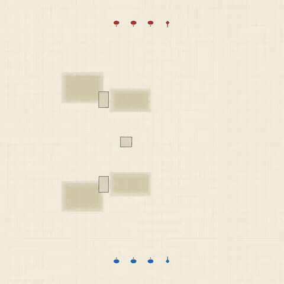
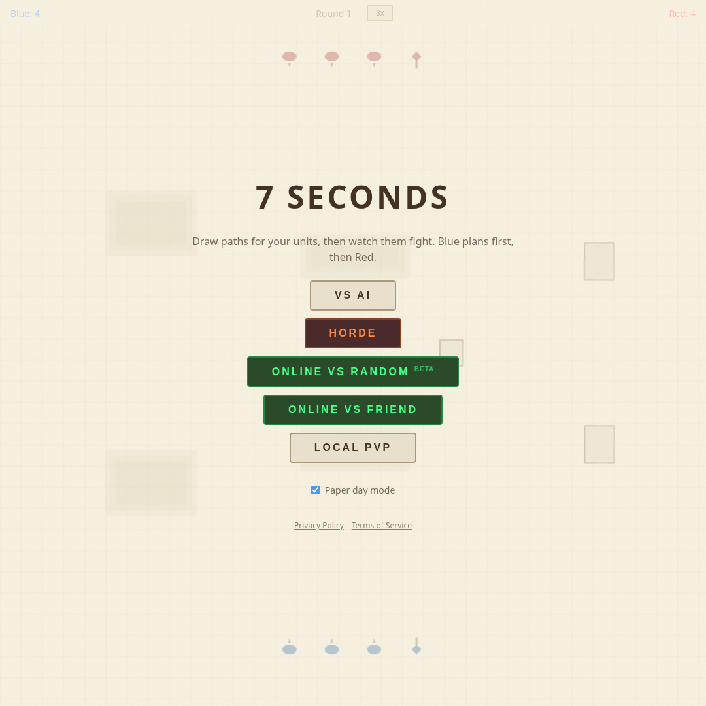
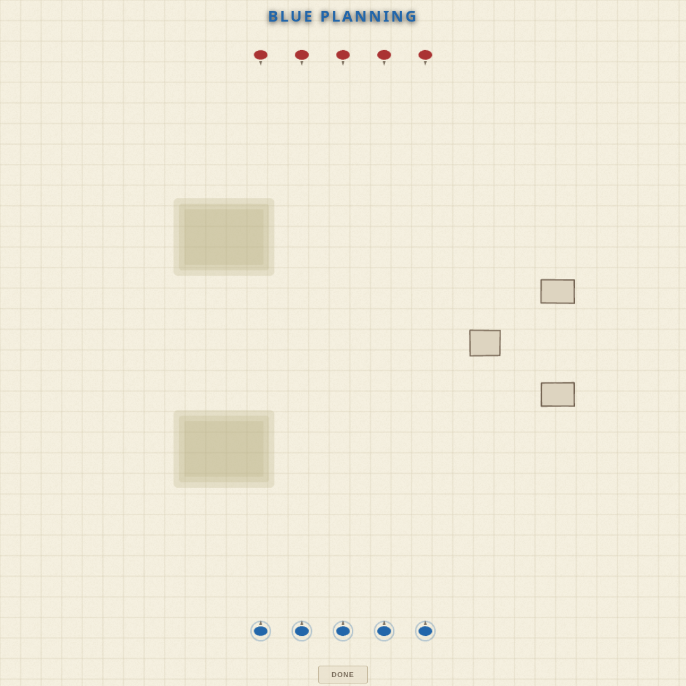
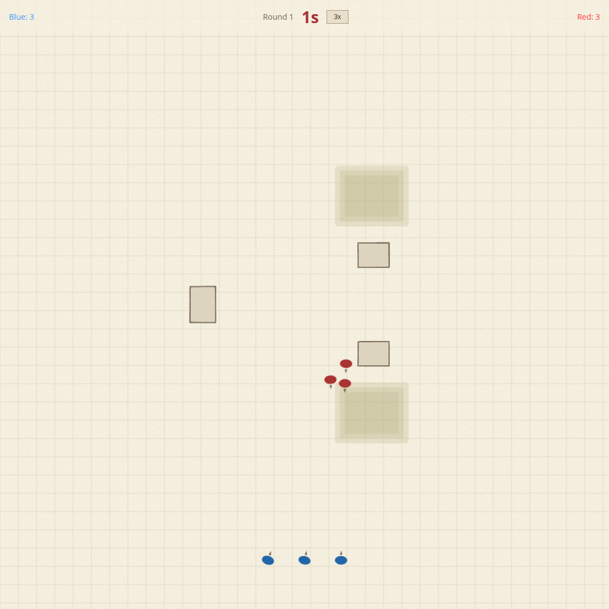
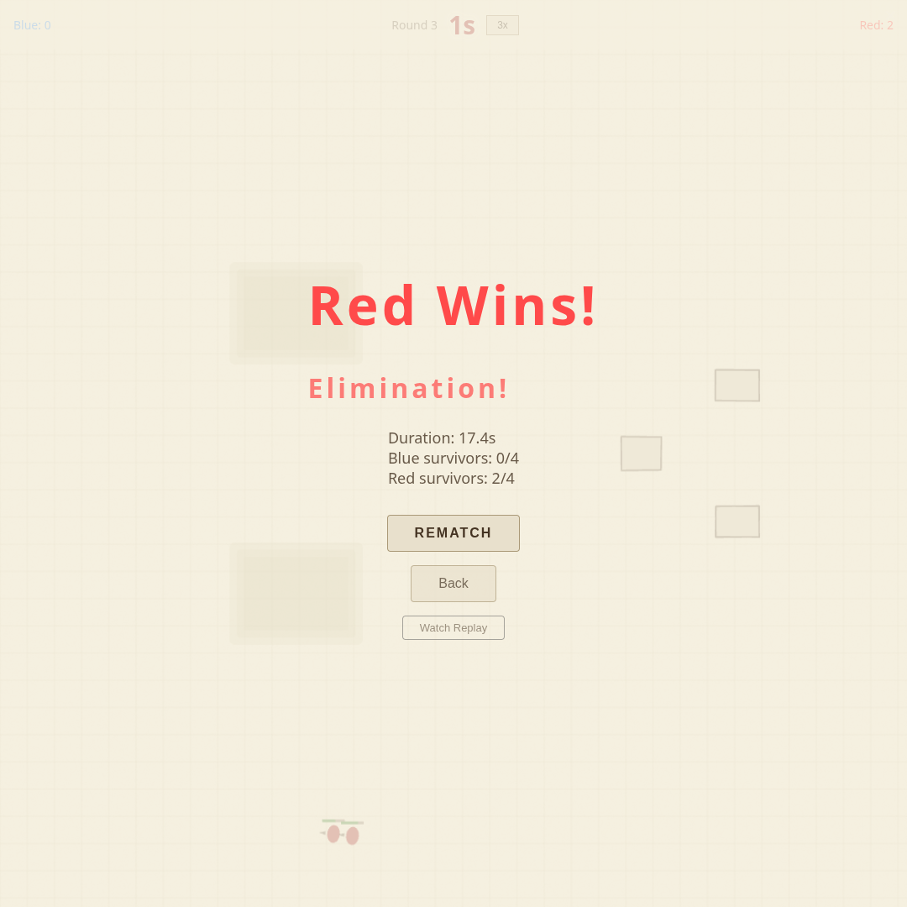
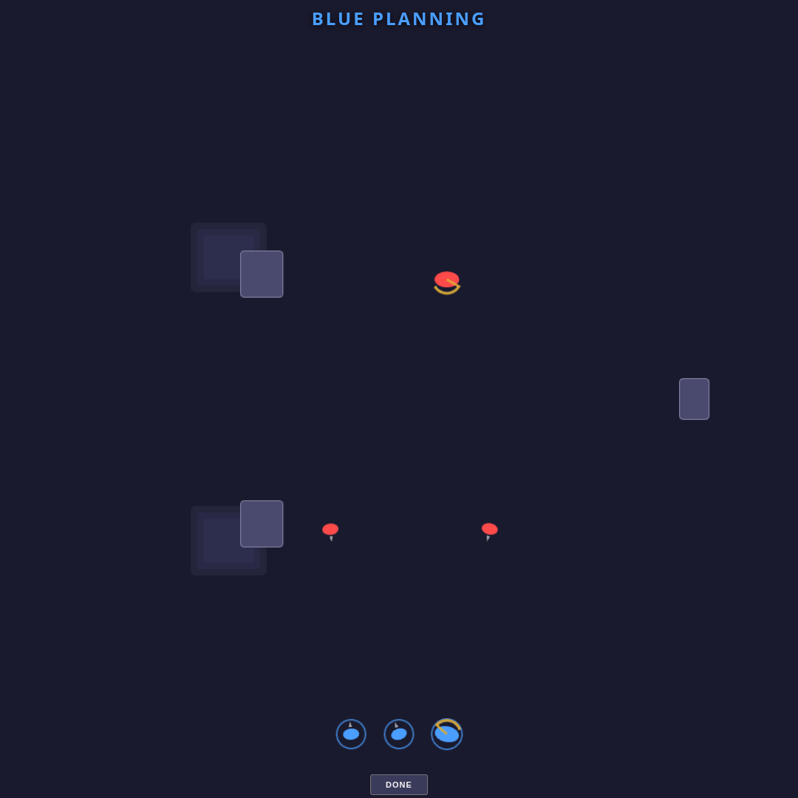
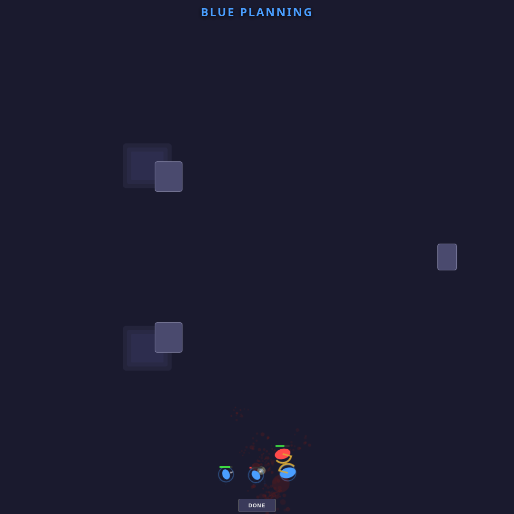

<p align="center">
  
</p>

<h1 align="center">7 Seconds</h1>

<p align="center">A tactical micro-strategy game. Draw paths for your units, then watch them fight.</p>

<p align="center">
  
</p>

## How It Works

1. **Plan** — Draw movement paths for each of your units
2. **Fight** — Units follow their paths and auto-engage enemies within range
3. **Repeat** — Survive multiple rounds until one side is eliminated

Terrain matters: elevation grants range bonuses, obstacles block movement and line of sight, and flanking deals extra damage.

## Game Modes

- **vs AI** — Single player against AI opponents, on Easy, Normal or Hard (Easy gives the AI one unit fewer and looser planning; Hard gives it an extra soldier). Your win/loss record and streak are kept per difficulty.
- **Daily challenge** — The same map, armies and battle seed for everyone each day. Your first finished attempt counts; share the result as a spoiler-free emoji summary.
- **Horde** — Survive 10 waves of increasingly difficult enemies, choosing upgrades between waves
- **Online vs Random** — Matchmake against a random opponent via Supabase Realtime
- **Online vs Friend** — Share a link and play against a friend
- **Local PvP** — Hot-seat multiplayer on the same device

## Unit Types

| Unit | Role |
|------|------|
| Soldier | Balanced all-rounder |
| Sniper | Long range, slow, fragile |
| Blade | Fast melee attacker |
| Shielder | Tanky frontline |
| Bomber | Area damage |
| Mortar | Lobs shells over cover at where enemies stand; can't hit close targets |
| Rocketeer | No gun; you draw its rocket's flight path, which launches at the end of its move |

## Screenshots

| Menu | Planning | Battle | Result |
|------|----------|--------|--------|
|  |  |  |  |

<details>
<summary>Night mode</summary>

| Planning | Battle |
|----------|--------|
|  |  |

</details>

## Tech Stack

- **Renderer**: [PixiJS](https://pixijs.com/) 8 (WebGL)
- **Online**: [Supabase](https://supabase.com/) Realtime (WebRTC peer-to-peer with relay fallback)
- **Mobile**: [Capacitor](https://capacitorjs.com/) (Android)
- **Build**: [Vite](https://vite.dev/) + TypeScript (strict)
- **Tests**: [Vitest](https://vitest.dev/)

Zero runtime CSS frameworks. Two themes (paper day mode, dark night mode) via CSS custom properties.

Sound effects and music are synthesized at runtime with WebAudio (no audio assets). Phones vibrate on kills and explosions (Capacitor Haptics on Android, the Vibration API on the web). Sound, music, vibration, reduced motion and theme are toggled from the main menu and saved locally; reduced motion follows the system setting by default.

## Development

```bash
npm install
npm run dev        # start dev server
npm run build      # production build
npm run test:run   # run tests
npm run screenshots  # capture every main screen at phone and desktop size into output/screenshots/
```

`npm run screenshots` needs Playwright with Chromium installed globally (`npm i -g playwright && npx playwright install chromium`) and fails if the page throws an error.

## Recording

After a battle, **Share clip** on the result screen plays the replay while recording it (with sound) and opens the share sheet, or downloads the video where sharing files isn't supported. It's hidden in the Android app, whose WebView can't share or download the recording.

Append `?record` to the URL to enable the built-in screen recorder. Press **R** during battle or replay to capture a WebM clip (max 15 seconds).

Run `npm run video:capture` to regenerate the square and 9:16 mobile action clips in `store-assets/`. The Playwright-driven capture includes path drawing before the battle and requires `ffmpeg`/`ffprobe`.
